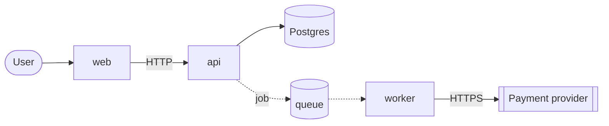

# Report template

````markdown
# Architecture review: <system>

**Question:** <what the review is for>. **Priorities:** <attributes>. **Load:** <current> now, <expected> expected (<source or "assumption">).

## Map



| Component | Responsibility | Owns data | Talks to |
| --- | --- | --- | --- |

Exposed to the internet: <list>. Holds secrets or personal data: <list>.

## Findings

| # | Severity | Area | Finding | Evidence | Smallest fix |
| --- | --- | --- | --- | --- | --- |
| 1 | High | Reliability | ... | `path:line` | ... |

## Improvement opportunities

| # | Opportunity | Evidence | Benefit | Size |
| --- | --- | --- | --- | --- |
| 1 | ... | `path:line` | Simpler, cheaper, faster or easier to change | Small, medium or large |

## What is fine

<One to three lines on what the system does well, so it is kept.>

## Open questions

- <What the repository does not show and the answer would change a finding.>

## Decisions to record

- <Choice the fixes require, as a proposed decision record title.>
````

Use a dotted arrow for asynchronous links. Keep findings to ten; group repeats of the same problem into one row.
